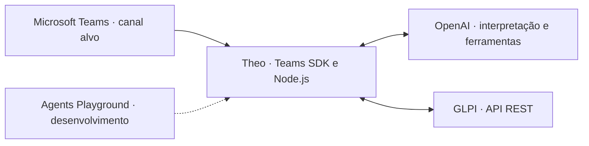

# Theo — agente de suporte para GLPI no Microsoft Teams

O **Theo** é um agente conversacional de suporte de TI cujo canal de atendimento é o **Microsoft Teams** e cujo sistema de chamados é o **GLPI**. Ele reúne o contexto do problema, orienta tentativas simples de solução e prepara chamados para revisão do usuário. Depois da abertura, permite consultar o andamento e receber atualizações na conversa.

O objetivo é facilitar o acesso ao suporte e entregar ao técnico um relato útil, com os sintomas e as tentativas já informadas pelo usuário.

**Em desenvolvimento:** o fluxo de atendimento, a integração com a API do GLPI e os Adaptive Cards estão implementados e podem ser executados no ambiente de desenvolvimento. A publicação no Teams real, a autenticação Microsoft e o vínculo de cada usuário ao solicitante no GLPI são a próxima etapa de integração.

## O que o Theo faz

- **Ajuda antes do chamado:** entende o problema e sugere passos simples e reversíveis, sem impedir que o usuário peça atendimento diretamente.
- **Coleta de contexto:** faz perguntas relevantes, aproveita o histórico e evita preparar chamados com descrições vagas.
- **Classificação automática:** sugere uma categoria do catálogo configurado, com um motivo para revisão.
- **Abertura com confirmação:** apresenta o resumo com os botões **Confirmar**, **Corrigir** e **Cancelar**. A gravação ocorre somente após a confirmação.
- **Consulta de chamados:** informa o status e as respostas públicas dos chamados acompanhados na conversa.
- **Notificações:** avisa quando há uma resposta pública ou mudança de status. Notas privadas são excluídas do fluxo.

A consulta à base de conhecimento do GLPI e a atribuição automática ao responsável estão previstas na [evolução do produto](docs/discovery.md#evolução).

## Como funciona o atendimento

1. O usuário conversa com o Theo e relata o problema ou pede um chamado.
2. O agente tenta ajudar ou coleta os detalhes necessários, conforme o pedido.
3. O Theo prepara um resumo com descrição, categoria sugerida e solicitante.
4. O usuário revisa e confirma. Também pode corrigir ou cancelar.
5. O servidor cria o chamado no GLPI e devolve seu número e link.
6. O usuário consulta o andamento e recebe avisos das atualizações acompanhadas.

Por exemplo, ao receber **“Quero acesso ao ERP”**, o Theo pergunta qual sistema e quais funções são necessárias antes de preparar o resumo. Pedir um chamado dispensa tentativas de diagnóstico; a coleta continua apenas enquanto faltar informação útil para o atendimento. O usuário pode escolher registrar com os dados disponíveis e revisar o resumo antes do envio.

## Arquitetura



O GLPI mantém o registro dos chamados. A IA reúne contexto, sugere a categoria e consulta ferramentas permitidas. A confirmação e a criação do chamado são controladas pelo servidor; o modelo não recebe uma ferramenta de escrita no GLPI.

| Componente | Tecnologia |
| --- | --- |
| Servidor e canal de mensagens | Node.js, JavaScript e Microsoft Teams SDK |
| Conversa e ferramentas da IA | OpenAI Responses API; modelo configurável |
| Chamados e acompanhamentos | API REST V1 do GLPI |
| Cartões e ações | Adaptive Cards |
| Ambiente de desenvolvimento | Docker Compose, GLPI, MariaDB e Microsoft 365 Agents Playground |

## Estado da implementação

| Capacidade | Estado |
| --- | --- |
| Diagnóstico conversacional e coleta de informações | Implementado |
| Classificação, revisão e abertura no GLPI | Implementado |
| Consulta e notificações na conversa | Implementado no ambiente de desenvolvimento |
| Tratamento de ações dos Adaptive Cards | Implementado com Teams SDK |
| Publicação e validação no Teams real | Pendente |
| Autenticação Microsoft e vínculo Teams → solicitante GLPI | Pendente |
| Consulta à base de conhecimento | Planejado |
| Atribuição automática ao responsável | Planejado |

Atualmente, o servidor aceita apenas o conector local do Playground e usa uma conta fictícia no GLPI. O armazenamento de conversas é um arquivo JSON para uma instância do Theo. A [documentação de desenvolvimento](docs/development.md) explica a execução e esses limites; as [decisões do produto](docs/discovery.md) detalham o caminho até a integração organizacional.

## Desenvolver e executar

O repositório inclui um ambiente com GLPI, banco de dados, Theo e Playground para desenvolver o agente sem depender de um tenant Microsoft 365. O Playground simula o canal de mensagens e permite exercitar o atendimento enquanto a integração com o Teams real é concluída.

Siga o [guia de desenvolvimento](docs/development.md) para configurar credenciais, iniciar os serviços e executar os testes. Para os testes automatizados, com Node.js 22.12 ou posterior:

```sh
npm ci --cache .npm-cache
npm test
```

## Documentação

- [Desenvolvimento, configuração e testes](docs/development.md)
- [Produto, decisões e evolução](docs/discovery.md)
- [Configuração de exemplo](.env.example)
- [Catálogo de categorias](config/categories.json)
- [Instruções e ferramentas do agente](src/agent.mjs)
